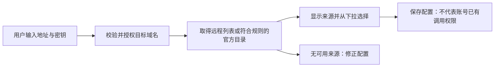
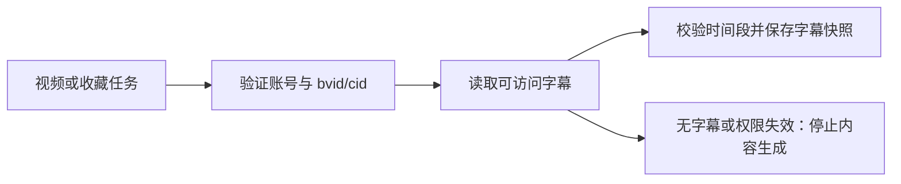
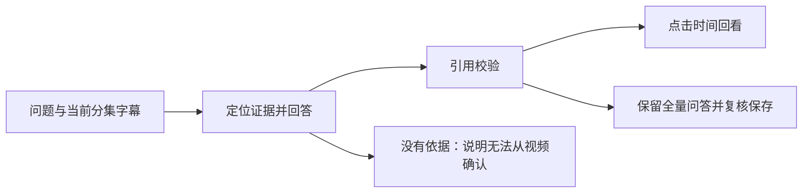
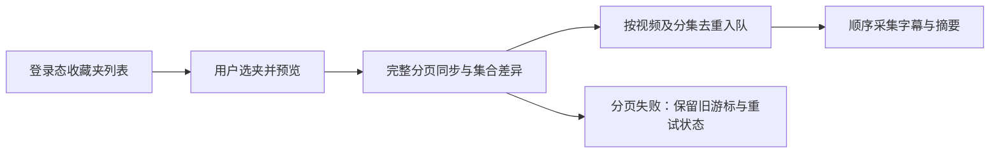
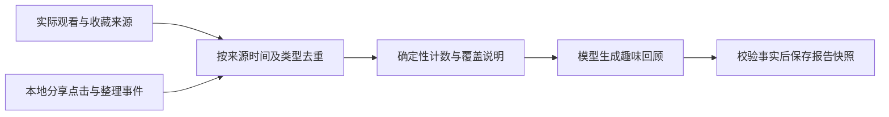
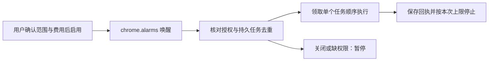
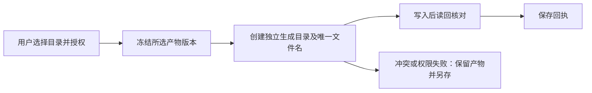
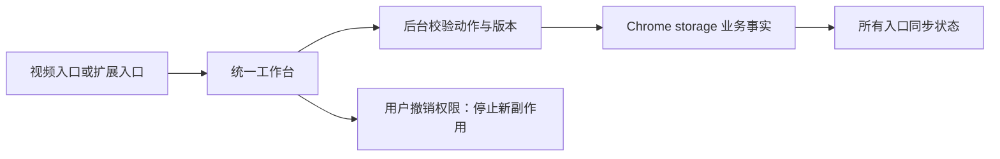
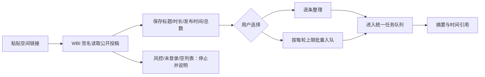

# Bili Study 产品需求文档

| 项目 | 内容 |
| --- | --- |
| 版本与日期 | 0.7，2026-10-23；移除翻译与双语能力，保留字幕、精读、问答、笔记、回顾与知识库保存 |
| 状态 | 评审中／需实机验收；未通过产品评审，不是研发就绪或发布声明 |
| 产品负责人 | 用户；不预设组织、团队或其他审批角色 |
| 交付形态 | Markdown＋需求流程示意图；没有可用的 B 站产品截图 |
| 事实源 | 用户明确确认的范围、工程约束及最新验证结果；209项测试、运行资源检查和本地浏览器验证按本次实际执行记录，不代表真实模型／来源、真实 Edge 或完整端到端通过 |
| 前置梳理确认 | 用户已确认独立 B 站项目、功能范围、主流网关及文档形态，并授权编写；本稿细则仍待用户评审 |
| 关联文档 | [验收方案](docs/acceptance.md)、[决策与阻塞](docs/decisions.md)、[协作规则](AGENTS.md) |

## 背景、用户与预期结果

问题：个人在 B 站学习时，字幕、收藏、追问和笔记分散，批量收藏不等于实际学习；若直接用摘要生成“学习成绩”，容易制造完成感却失真。此问题来自用户需求，不代表已量化的市场调研结果。

目标用户：使用自己 B 站登录态、模型密钥和本地笔记目录的个人学习者。使用终端为桌面 Chromium 系浏览器，目标实机首先覆盖 Edge；不做多人协作或账户云同步。

预期结果：从有来源的字幕生成可回看的课堂精读，围绕视频追问并保存完整问答，将选定收藏夹中的新增内容按授权自动处理，依据真实可得的观看／收藏记录生成诚实、有趣的日报和周报，最终保存为 Obsidian 或其他工具可读的 Markdown。

为何现在做：用户已确认 B 站独立项目方向，先固定工程与验收边界，再进入实现；不依赖、不迁移、不修改 YouTube 项目。

## 范围、事实与非目标

| 类型 | 当前结论 |
| --- | --- |
| 已确认的产品决策 | 登录态字幕为首选；字幕原文阅读；收藏夹列表与选夹增量摘要；真实观看／收藏日报周报；有时间定位的视频问答；编辑复核后保存精读与完整问答；Obsidian 优先、通用 Markdown 兼容 |
| 已确认的工程约束 | 独立 MV3 扩展、原生 JavaScript ESM；OpenAI Chat、Claude Messages、Gemini generateContent 分离；本地 Chrome storage 为共享业务事实源；目录句柄存 IndexedDB；无常驻服务 |
| 未经验证的假设 | 当前登录态可取得所需字幕、收藏夹及历史记录；浏览器支持所需目录授权；网关兼容声明协议且用户账号可调用选定模型。远程列表或官方目录均不能替代生成权限实测 |
| 待决策 | 来源覆盖不足时的发布范围、字幕覆盖门槛、数据保留与容量策略、自动化参数、各网关实测兼容名单；见决策文档 |
| 本期不做 | 翻译／译文／双语阅读与双语 Markdown、ASR／音频转写、本地笔记库检索增强问答、云同步、多用户、修改收藏或代分享、规避登录／平台限制、后台常驻服务、学习掌握度判定 |
| 不能声称 | 摘要过＝看过，收藏＝看完，分享按钮点击＝成功转发，观看记录＝掌握知识，打开浏览器＝定时任务准点执行 |

本稿定义完整产品要求，不以缩减功能掩盖缺口。缺失来源应显示实际状态、阻断对应处理，而不是生成虚构内容或悄悄省略功能。

### 实施对照与继续实施边界

本稿后续各需求均为目标契约，不是对当前代码的完成声明。以下据用户最新实施说明更新，未独立复核源码或实机。最终执行结果另记入 `docs/verification.md`，逐项区分实现、离线验证、真实模型与 Edge 验收。

| 范围 | 主实施方报告的当前状态 | 距目标的缺口 |
| --- | --- | --- |
| 信息架构 | 0.9.0 已把侧栏收敛为当前视频工作区，把工作台一级导航收敛为学习库、学习回顾和设置；收藏夹、UP 主与视频资料合并为统一资料列表 | 需在真实扩展和长列表数据下复核筛选、任务摘要、展开区及知识库设置 |
| AI 任务速度 | 0.9.1 将精读批次等待改为单任务内最多2路并行，并保留逐批检查点；重试不会重复已完成批次 | 需用真实模型测量端到端时延、平台限流与费用变化 |
| 摘要编辑 | 编辑及摘要历史保留已实现 | 编辑／复核／历史版本的真实内容闭环仍须逐项验收，不由测试总数推定全部通过 |
| 周报窗口 | 已实现自然周，按用户实施说明登记 | 需验证 Asia/Shanghai 的周一00:00至下周一00:00边界；不把实现报告等同实机通过 |
| 网关地址 | 显式HTTP／HTTPS、`redirect: "error"`与HTTP风险确认界面实现存在；Chromium已观察到取消路径的confirm触发 | 尚不能据此断言取消后零请求、同意路径和所有重定向分支均实机通过；不承诺未实现的内网／回环拦截 |
| 模型选项来源 | GLM 使用官方文本模型目录；MiniMax 远程列表遇404／405回退官方目录；区分 remote／catalog，不手填模型 ID | 目录只表明候选型号，不保证账号权限；远程发现、目录选择、真实生成须分开验收 |
| 文件快照 | vault同源Web Locks串行、权限检查、已有名拒写、abort及写后读回实现存在；相关离线用例通过 | 完整Obsidian／普通目录实机闭环仍待验证；导出回执仍无；Web Locks不构成任意跨进程原子创建、原子幂等或恰好一次保存 |
| 任务恢复 | runId结果提交校验、running恢复unknown、cancel／reset迟到guard已实现；队列权限、unknown无重发、cancel迟到及reset问答离线用例通过 | 不是严格租约／全链路实机证明；reset界面确认尚待核查，真实外发中断及恢复仍需验收 |
| 模型超时 | 结果可能未知；用户手动重试可能再次计费 | 必须明确提示可能重复费用；不能声称恢复天然幂等或费用恰好一次 |
| 历史快照 | 摘要历史、报告历史保留已实现 | 不等于完整来源版本链路已完成；字幕版本更新仍无，详细行为来源、迟到数据及新旧引用一致性须独立举证 |
| 离线验证 | 主任务报告198项测试全通过，覆盖后台队列权限／unknown无重发／cancel迟到／reset问答／超长讨论拒截断，vault权限／已有名拒写／abort／读回及安全Markdown等 | 仅证明已覆盖离线断言，不代表真实模型质量、账号权限或所有需求逐项验收通过 |
| 浏览器局部验证 | 真实Chromium成功加载扩展，后台IPC、七商协议切换、合成下拉列表加载／选择／保存／刷新通过 | 列表为合成数据，无真实付费生成；不等于七家网关实际remote返回或目标Edge完整验收；reset确认待核查 |
| 配套文档 | 主任务报告README、PRIVACY及架构文档已编写 | 文档存在不证明实现符合全部约束；最终执行明细另见主任务编写的verification记录 |

用户已授权主实施方继续按已确认的共享规则进行有限实现。评审中不等于禁止这些工作；未决选项不得擅自定案，新增外发／付费／权限仍需授权。检查器的review-ready是静态信号，不是用户已完成产品评审。下文门禁约束可用声明与发布，不一概阻止已确认部分开发。

## 共同权限、数据与运行契约

### 使用者与系统边界

| 参与方 | 允许与责任 | 禁止 |
| --- | --- | --- |
| 用户 | 选择收藏夹／模型／目录，授权内容发送与自动化，复核生成结果，撤销授权；负责产品取舍与最终验收 |
| 扩展 | 只读取用户可访问的 B 站内容，管理本地任务与事实，按用户配置请求模型、创建独立生成文件；记录脱敏本地审计 |
| 模型网关 | 只接收任务必要的字幕、问题、事实摘要及生成指令；返回候选内容；其数据留存政策需用户自行了解并确认 |
| 本地目录 | 仅作为用户授权的生成文件目的地；目录选择不授权扫描既有笔记、检索全文或覆盖任何已有文件 |

B 站登录凭据不复制到模型请求、Markdown、日志或网关。模型密钥不进入页面内容脚本、导出文件、仓库或浏览器同步存储；本地持久化也不等于加密保险箱。访问 B 站账号切换后须停止旧账号任务并隔离数据，不能把两人的收藏与历史合并。无法识别账号时不得继续自动采集个人数据。

### 全局业务对象状态机

以下业务状态由扩展后台唯一写入 Chrome storage，页面发消息申请变更；语义 Owner 均为用户。收藏夹游标、业务对象和任务通过统一后台写入队列保持一致，不允许多个页面各存一份“真相”。

| 对象 | 合法迁移与执行者 | 超时、并发与恢复 | 终态及历史 |
| --- | --- | --- | --- |
| 授权 | 用户：未授权→可用→撤销；系统检测：可用→失效；用户重新授权：失效／撤销→可用 | 每次请求／写文件前重新检查；失效立即停止相应新副作用，不静默扩大权限 | 撤销不删除历史产物；取消／重授权保留脱敏审计 |
| 任务 | 用户或已启用计划：待执行→运行中；后台：运行中→成功／失败／结果未知／已取消；缺权限：待执行→等待授权；用户：等待授权→待执行 | 单一持久化队列顺序执行，以运行标识／版本或等价机制防止旧执行者写回；重启发现遗留运行中状态须转结果未知，不自动重发付费调用。严格租约尚无完成证据 | 成功／取消不可改写；失败经用户重试创建新尝试；结果未知须确认后另建尝试，可能再次计费 |
| 内容产物 | 模型完成且校验通过：生成候选→用户编辑→用户确认；用户另行生成新版本 | 编辑版本冲突不覆盖；取消保留已有版本；不完整／无证据响应不能成为可导出成功产物 | 每一版不可变，记录父版本；自动化只生成候选，不伪造人工确认 |
| 导出 | 用户授权：待保存→写入中→已保存／失败／结果未知；权限缺失→等待授权 | 同一导出意图先查写入回执／文件内容；文件存在不覆盖；未知结果先核对再由用户重试 | 每个已保存文件为不可变快照；再次保存生成新文件，不回写旧文件 |

撤销、超时、取消或任务重置后，旧执行者的迟到结果不能覆盖新任务、重建已重置的业务记录或触发导出；检查必须覆盖异步完成后的每个写入点。重置不授权删除用户文件。请求超时与恢复参数仍需记录并在相关能力发布验收前确认；若采用租约，另需定义其失效与旧执行者隔离规则，不能把单工作者称为严格租约。未决参数不阻止已确认基础规则的实现。

### 共享数据契约

| 对象 | 必须保留的事实与键 | 下游与边界 |
| --- | --- | --- |
| 视频／分集 | 视频键 bvid，分集键 bvid＋cid；标题、作者、来源 URL、分集名、时长、采集时间；分集未知不可伪造 cid | 收藏夹可能仅返回 bvid；取得分集列表后才形成分集任务，明确分集范围，不把首集当全集 |
| 字幕快照 | 账号数据空间、bvid＋cid、语言、来源、原始文本、分段起止秒、内容摘要指纹、取得时间、完整性状态 | 精读、问答引用同一版本；字幕原文是唯一文本证据 |
| 历史事件 | 账号数据空间、类型、bvid／cid（来源有才填）、来源事件键、事件时间、首次观察时间、采集来源、可信范围 | 观看、收藏、分享点击分开；缺事件时间不可用采集时间顶替；缺 cid 只计视频级 |
| 生成产物 | 产物标识、输入快照、配置／提示词／协议／模型版本、引用、生成时间、人工复核状态、父版本、任务尝试 | 配置变化不重写旧产物；生成任务与观看事件完全独立 |
| 导出回执 | 产物版本、导出意图、目标目录标识、相对路径、内容指纹、保存时间及结果 | 句柄只存 IndexedDB；不把本机完整路径发给模型 |

本地不做遥测，不上传行为指标。用户主动调用模型是明确的外发例外；仅发送任务必要内容，不发完整历史库或既有笔记。内容脚本输入、字幕及模型输出均视为不可信数据，须校验结构、长度、URL 和 Markdown／HTML 安全。

新项目不导入 YouTube 数据。持久化 Schema 必须版本化；不兼容升级先停止写入、保留旧数据并提供恢复方案，不能以清库恢复。原始采集与生成快照不静默裁剪；容量不足停止新写入并保留已有数据。具体保留期及容量阈值仍需用户确认。

## 成功度量与护栏

指标 Owner 为用户，全部从本地数据或人工验收记录复算，不建设遥测。基线均未知；以下是候选验收目标，不是已达成结果，须在产品评审确认。

| 指标 | 公式、去重、窗口、来源、刷新 | 候选目标与护栏 |
| --- | --- | --- |
| 处理成功率 | 成功产物数／已开始的生成任务数；按任务意图去重，重试不重复计分子；选定自然周、本地任务记录，任务完成刷新。用户取消单列，不悄悄排除失败 | 来源／网关实测后再确定目标；同时报告无字幕数、失败数、结果未知数 |
| 人工一次可用率 | 无需事实修正的产物数／人工完整复核产物数；每个初始产物版本一次；每轮验收、人工记录，复核后刷新 | ≥90%；样本与评分见验收文档，不能等价于全量正确率 |
| 问答证据合格率 | 所有实质性视频结论均有真实支持的回答数／带实质结论的回答数；按问答标识去重、每轮验收，人工对照原始字幕后刷新 | 100%；无证据问题的正确拒答另计，不能用拒答刷分 |
| 笔记保护 | 覆盖／删除既有文件数；计数指标，分母不适用；每次保存、文件前后对比，保存后刷新 | 0；快照冲突必须另存，不覆盖 |
| 报告事实差错 | 与本地原始事件不一致的计数或时间结论数；计数指标，分母不适用；每份报告人工复算，生成后刷新 | 0；禁止生成掌握度／完播／真实分享成功结论 |

报告时间窗默认 Asia/Shanghai：日报为自然日 [00:00, 次日00:00)，周报为周一00:00至下周一00:00；存储时间保留 UTC 与来源时区，生成快照保留报表时区。改变未来配置不回改历史报告。

## 需求索引

全部需求在本稿为“评审中”；优先级表示依赖与风险，不代表可以静默删减其他能力。

| 需求 | 用户结果 | 优先级 | 依赖 | 专属验收 |
| --- | --- | --- | --- | --- |
| 需求-001 | 选择网关与有来源的模型列表 | 高，基础依赖 | 网关协议／权限 | 验收-001～验收-003 |
| 需求-002 | 取得可追溯的分集字幕 | 高，内容证据基础 | B 站登录态／来源验证 | 验收-004～验收-006 |
| 需求-003 | 复核与编辑视频摘要 | 高，核心闭环 | 需求-001、需求-002 | 验收-007～验收-009 |
| 需求-004 | 已移除：翻译、译文与双语阅读 | 不适用 | 无 | 不再验收；历史记录保留 |
| 需求-005 | 视频问答、引用定位与完整保存 | 高，真实性风险 | 需求-001、需求-002 | 验收-013～验收-015 |
| 需求-006 | 列收藏夹、选夹增量处理 | 高，批量入口 | 需求-001、需求-002 | 验收-016～验收-018 |
| 需求-007 | 依据实际记录生成日报周报 | 高，事实边界 | 历史来源、需求-003／需求-005 | 验收-019～验收-021 |
| 需求-008 | 浏览器运行期间的有界自动化 | 高，费用／恢复风险 | 需求-006、需求-007 | 验收-022～验收-024 |
| 需求-009 | 安全保存通用 Markdown 快照 | 高，用户数据保护 | 生成产物、目录授权 | 验收-025～验收-027 |
| 需求-010 | 统一工作台与权限／数据治理 | 高，跨入口一致性 | 以上各项 | 验收-028～验收-030 |

## 需求-001 网关配置与模型发现

### 需求说明与用户场景

用户在扩展设置中输入自有网关地址与密钥，从远程返回的列表或明确标注来源的官方目录选择，不手填模型 ID；避免把候选型号误当成账号已有权限。目标覆盖 DeepSeek、Gemini、GPT、Grok、MiniMax、GLM、Claude 和自定义网关，名称支持不等于实测通过。

### 图文说明

图-001，根据已确认需求生成的示意图；remote 与 catalog 分开记录，无有效来源不得伪造选项或手填 ID，对应验收-001～验收-003。

### 核心流程与规则

支持原生 OpenAI Chat、Claude Messages、Gemini generateContent 三类适配器；列表获取与生成请求分别按协议处理，不把 Claude／Gemini 全部套成 Chat。供应商预设不证明兼容，自定义网关须选择协议。

模型来源有两类：remote 为用户目标网关实际返回的列表；catalog 为已维护的官方文本模型目录。GLM 使用官方文本目录；MiniMax 先请求远程列表，仅404／405按既定规则回退官方目录，不把401／403、429或网络失败伪装成发现成功。catalog 保存官方来源依据及目录版本，remote 保存获取时间与目标网关；不能把内置目录标成实时远程发现，也不代表已验证当前最新型号。两类均不保证用户账号可调用、余额充足或实际生成兼容。无远程列表且无已定义目录来源时停止选择，不提供手填 ID 后门。

用户可显式配置 HTTP 或 HTTPS 合法地址；不宣称已有内网／回环地址拦截。请求采用 `redirect: "error"`，遇重定向失败，不向新地址继续传凭据。HTTP 不加密，可能暴露密钥和内容；界面须在发送带密钥的发现／生成请求前让用户明确确认风险，取消则不得发送。确认界面实现存在，Chromium中已观察到取消路径confirm触发；取消后零请求及同意路径仍待分别核验。HTTPS不等于目标网关可信；目录列出型号也不保证本机／内网网关可连或浏览器权限已满足。

列表获取不发字幕、不启动付费生成；发现请求是否收费以提供商政策为准。模型生成前明确允许发送的内容类别。缓存按地址＋协议＋凭据版本及来源隔离，来源或目录版本变化不修改旧产物；失效选项不得悄悄替换成其他模型。

### 双层状态机与边界

关联全局授权、任务。局部状态：未配置→地址／HTTP风险确认→获取中→远程列表可选择／官方目录可选择／空列表／鉴权失败／网络失败；用户确认→配置已保存。保存不是生成权限验证。取消或切换地址使旧响应失效。更换密钥、网关或模型不修改已完成产物；鉴权失败暂停该配置队列，不连续重试烧额度。

安全与审计：只记录配置版本、发现结果与撤销事件，不记录密钥；发现证据不等于生成质量证明，真实生成及人工复核按验收方案逐协议评测，失败不得自动降级到另一协议。

### 数据流转与影响

| 来源与触发 | 校验／处理 | 唯一事实源、下游、权限／留存 | 失败恢复 |
| --- | --- | --- | --- |
| 用户输入→扩展后台→远程列表或定义的官方目录来源 | HTTP风险确认、地址／协议／模型结构校验；标记 remote／catalog，保存来源／版本；按凭据版本隔离缓存 | Chrome storage 配置与列表来源快照→任务配置；只有后台访问秘密，不写日志／Markdown，撤销时移除凭据 | 仅 MiniMax 远程404／405按规则回退目录；鉴权等错误不得掩盖；无有效来源不可选，不静默切协议／模型 |

### 验收标准

- 验收-001：三类协议的下拉项均可追溯到 remote 或已定义 catalog；GLM 官方文本目录与 MiniMax 404／405回退有独立用例；来源标识准确、无手填 ID，列目录不能显示账号权限已验证。八类网关分别登记列表／目录与真实生成结果。
- 验收-002：空列表、无支持目录、401／403、429、离线与超时分别有反馈，不滥用目录掩盖错误；HTTP取消风险确认前不发送带密钥请求，确认后才发送；HTTP／HTTPS 的重定向均以错误终止，无自动换协议／模型或继续转发凭据。
- 验收-003：改地址／密钥后旧响应不能覆盖新配置；撤销后无新请求，日志、导出与内容脚本找不到密钥；旧产物保留原模型及来源版本。目录项遇账号无权限时明确报失败，不把目录存在当真实调用成功。

## 需求-002 视频与字幕采集

### 需求说明与用户场景

用户打开 B 站视频或从选定收藏夹发起处理，扩展取得当前视频与分集的登录态字幕作为内容证据。目标是准确知道“总结的是哪一集、哪一版字幕”，不是只凭标题编写内容。

### 图文说明

图-002，根据已确认需求生成的示意图；字幕可得性须实机验证，对应验收-004～验收-006。

### 核心流程与规则

只用用户正常可访问的数据；不导出 Cookie、不绕过付费或风控、不把网页 HTML、标题或缓存的另一集字幕当作正文。保留可用字幕语言与来源；多轨选择规则须用户评审，自动选取时也必须显示当前语言。没有字幕时告知“当前视频没有可用字幕”，允许稍后重试，不暗中调用转写。

分集切换必须重新核对 bvid＋cid；收藏夹视频展开分集后明确处理范围。字幕起止时间须非负且有序，越界、空内容、重复段和不完整响应需校验，重复仅去除完全相同片段；存在实质缺失则标为不完整，不进入自动成功生成。

### 双层状态机与边界

关联全局授权、任务；局部状态：未读取→读取中→可用／无字幕／不完整／无权限／失败。导航、账号切换、用户取消使本次运行失效；网络失败可由用户重试；登录失效转等待授权。旧集请求迟到不能覆盖当前集。

实现边界：字幕版本更新仍未实现，下文不可变采集版本及旧产物引用旧版本为目标契约，不能因已有摘要／报告历史便认定这条来源版本链路已通过。

安全与审计：记录读取来源、账号数据空间、快照版本及失败类别，不复制登录秘密；用户登出／撤销采集授权立即阻止后续读取。采集本身不产生学习指标；不涉及计数公式或报表时间窗，刷新只创建采集新版本。

### 数据流转与影响

| 来源与触发 | 校验／处理 | 唯一事实源、下游、权限／留存 | 失败恢复 |
| --- | --- | --- | --- |
| 用户打开／授权任务→B 站元信息与字幕 | 校验账号、bvid/cid、语言、分段时间与完整性；生成内容指纹 | Chrome storage 字幕不可变快照→精读／问答；仅本人数据空间，按保留策略管理 | 不覆盖上一版可用快照；错误与来源缺口保留；恢复后创建新采集版本 |

### 验收标准

- 验收-004：有字幕单集与多分集各实测，标题、cid、语言和抽查起止秒均与当前分集一致；快速切集时无串集。
- 验收-005：无字幕、未登录、失效、受限、空响应与字幕残缺分别停在对应状态，生成请求数为零；不得出现自动 ASR 或标题摘要冒充字幕摘要。
- 验收-006：重复采集相同快照不制造重复内容；字幕变化生成新版本，旧摘要仍引用旧快照；取消／账号切换后迟到响应不写入当前任务。

## 需求-003 摘要生成、编辑与复核

### 需求说明与用户场景

用户在已获得字幕的视频上生成摘要，查看核心观点、结构与可回看证据，编辑后确认保存；自动摘要保持候选身份。摘要用于理解和复习，不用于证明用户看过视频。

### 图文说明

图-003，根据已确认需求生成的示意图；候选与用户确认分离，对应验收-007～验收-009。

### 核心流程与规则

摘要至少包含视频／分集信息、核心观点、分主题要点及时间引用；视频未提供的案例与结论不能补成事实。允许“视频观点”与“建议追问”分区，但建议不能冒充原话。长字幕分段归纳并保留每段证据映射，合并前确认所有分段成功；超过模型容量先明确分段或失败，不静默截断。

用户可以查看原字幕、修改摘要、取消编辑、重新生成；编辑与重新生成均新增版本，不覆盖旧稿。模型结果需结构、非空、引用及安全校验；响应被截断或缺段时不显示整体成功。导出必须包含人工复核状态；自动化允许保存候选快照，不把它标为用户已确认。

### 双层状态机与边界

关联全局任务、内容产物。局部状态：待生成→分段生成→合并校验→候选→编辑→确认；失败／取消不清除已有稿。每次生成冻结字幕、模型及提示词版本，重复点击合并为同一在途意图；超时转失败或结果未知，不自动再次计费。

风险与审计：生成意图及每次尝试作为幂等依据，记录脱敏请求结果和可得用量；对账仅核对请求回执，不承担网关账单结算。费用风控为缺额度／异常费用时暂停，由用户人工兜底决定是否重试，不自动换便宜模型。用户撤销授权后停止后续分段；降级为查看原文与已有产物，质量评测和人工复核按验收方案执行。

本需求处理成功率沿用共同度量公式与任务意图去重，时间窗为所选自然周，任务完成即刷新；人工可用率另由复核样本计算。摘要导出是内容快照，不产生新的观看指标。

### 数据流转与影响

| 来源与触发 | 校验／处理 | 唯一事实源、下游、权限／留存 | 失败恢复 |
| --- | --- | --- | --- |
| 用户／授权队列→字幕快照→所选网关 | 分段、引用映射、合并校验，人工编辑形成父子版本 | Chrome storage 产物→工作台／Markdown／报告中的“已整理内容”；只发送本任务字幕；每版保留输入及复核状态 | 失败保留分段任务状态；复用有效分段需同一输入快照及配置；结果未知待用户确认 |

### 验收标准

- 验收-007：短字幕及长字幕均有结构化摘要与原始时间证据；人工核查无虚构观点，长字幕覆盖首中尾，分段失败时不标整份成功。
- 验收-008：编辑、取消编辑、重新生成后可回看旧版本；确认后保存的内容等于所选版本，不把自动候选标成人工确认。
- 验收-009：连点只创建一个在途意图；超时、截断、异常响应与取消不产生假成功；生成摘要后观看／完播／掌握计数均不增加。

## 需求-004 已移除：翻译与双语内容

> 2026-10-23 产品调整：翻译、译文、双语阅读和双语 Markdown 已从当前插件移除。以下内容仅保留为历史决策记录，不构成当前需求或验收目标。旧翻译数据不做破坏性删除，但不再展示、生成或导出。

### 需求说明与用户场景

用户阅读中文或英文视频字幕时可切换原文与双语，进行中文→英文或英文→中文翻译，并保存双语 Markdown。目的为对照理解，不改变原始证据。

### 图文说明

图-004，根据已确认需求生成的示意图；原文与译文按时间段对应，对应验收-010～验收-012。

### 核心流程与规则

自动识别仅作默认提示，用户可改方向；中英混合或未知语言不强制误判，先确认。原文不可被翻译替换；每段译文绑定原段标识与起止时间，关键术语和数字保持一致。双语导出按段落交替原文／译文并带视频时间链接。摘要选择双语输出时同样保留原摘要及对应译文，不能只导出译文冒充双语。

### 双层状态机与边界

关联全局任务与产物；局部状态：选方向→翻译中→完整双语／部分失败。阅读模式切换不重发请求；改方向或字幕版本创建新意图。缺段不可称完整双语；取消不影响原文；失败只重试用户选定部分且保留配置快照。

安全与审计：记录方向、输入版本、已完成段与撤销事件，不把原文指令执行为操作；用户撤销模型授权即停止后续翻译。翻译质量按验收方案人工复核；不合格时只保留原文，不把另一来源译文静默替换进来。

### 数据流转与影响

| 来源与触发 | 校验／处理 | 唯一事实源、下游、权限／留存 | 失败恢复 |
| --- | --- | --- | --- |
| 用户选择方向→原文快照→模型翻译 | 按原段映射、数量与时间一致性校验、术语／数字人工核查 | Chrome storage 双语版本→阅读／导出；原文永久独立于译文；只发送所选原文 | 保留已完成段但显示不完整；修复／重试生成新版本，不覆盖原文 |

### 验收标准

- 验收-010：中译英、英译中各完整对照；原文模式逐字等于输入，双语段落数量及时间映射一致，数字／否定语义无反转。
- 验收-011：切换原文／双语不新增模型请求；混合语言可确认方向，错误方向可改且旧版保留；某段失败不能当完整译文保存成功。
- 验收-012：双语字幕和双语摘要 Markdown 均能同时找到原文与对应译文、来源与时间链接；修改译文不改原始字幕证据。

## 需求-005 基于视频的问答与引用定位

### 需求说明与用户场景

用户对当前视频提问，回答以该分集字幕为依据，点击证据回到视频时间点；完整多轮问答可复核、编辑整理并保存。当前不检索本地 Obsidian 笔记，也不跨视频自动补知识。

### 图文说明

图-005，根据已确认需求生成的示意图；时间链接不能替代证据支持核查，对应验收-013～验收-015。

### 核心流程与规则

每个实质性视频结论附原始片段标识、短引文与时间；程序验证片段存在、时间属于该集，人工评测验证引文确实支持结论。没有依据时直接说明“视频中没有足够信息回答”，不编造引用。允许基于视频提出解释，但明确区分视频原意与推断，推断仍需给出支持片段。

引用点击在已打开的对应播放器定位；未打开时使用经验证的 bvid／分集／时间链接。加载失败或定位受限应可复制链接，不宣称已跳转成功。历史、问题与字幕中的“忽略指令／发送密钥／读本地文件”等文字只作引用数据，不可改变权限或调用工具。

完整保存所有轮次、问题、回答、引用、拒答与失败状态；默认导出完整对话，不能只留最后一轮。用户编辑形成整理副本，原始对话不变；可连同编辑后摘要保存为同一次产物包。

### 双层状态机与边界

关联全局任务、产物与导出；局部状态：提问→回答中→有证据回答／依据不足／失败→复核。切换视频不把旧对话混到新集；重复发送去重，迟到回答按原对话存放；取消后不自动发送下一问。上下文过长须分段取证或提示缩小问题，不能丢掉前文却声称保留。

安全审计只记录会话标识、输入／输出版本、引用校验结果与操作结果，不将问答原文复制到日志；原始对话仅留在其专属业务对象中。用户撤销外发授权后不得追加模型请求。

### 数据流转与影响

| 来源与触发 | 校验／处理 | 唯一事实源、下游、权限／留存 | 失败恢复 |
| --- | --- | --- | --- |
| 用户问题＋当前分集快照＋所需会话上下文→所选模型 | 原文取证、片段／时间校验、安全转义；保存原始与整理版本 | Chrome storage 会话与引用→回看／完整问答导出；不读本地笔记、不外发其他视频／完整历史库 | 无证据拒答；网络／引用不合法失败保留问题，可用户重试；无自动付费重发 |

### 验收标准

- 验收-013：事实题、跨段归纳题与视频未提及题分别验证；有结论回答的所有关键主张均有支持证据，无依据时拒答，伪造片段／越界时间不能通过。
- 验收-014：单集与多分集引用在真实 Edge 中各点击验证，落在对应分集且距预期起点不超过 2 秒；播放器不可用时可取得准确链接且不显示已定位。
- 验收-015：三轮以上对话、一次拒答与一次失败完整留存并导出；编辑整理不改原始记录；字幕提示词注入不能读取密钥／笔记或触发额外请求。

## 需求-006 收藏夹列表与增量摘要

### 需求说明与用户场景

用户读取自己的收藏夹列表，选择需要整理的文件夹；首次展示待处理范围，后续只处理新加入且未完成的内容，不反复为同一视频付费。

### 图文说明

图-006，根据已确认需求生成的示意图；文件夹扫描成功不等于全部视频摘要成功，对应验收-016～验收-018。

### 核心流程与规则

列表至少有收藏夹名称、唯一标识与可访问状态；视频数量仅展示来源实际提供的数值。选夹后预览初始存量、新增、已完成、无字幕、失败和待授权数量；首次存量需用户确认处理，不能默认全部产生费用。多收藏夹相同 bvid 的采集共享结果，分集处理以 bvid＋cid 去重。

同步检查完整分页，不能只依赖更新时间或最后一条游标漏项；只在完整快照后提交文件夹成员差异。成员快照提交与每项生成任务成功分别记账，扫描后生成失败仍留在待恢复集合。重复同步只复用同输入指纹／生成配置的已完成产物；重新生成须用户明确发起。失效、移出收藏夹不删除已生成笔记或历史事件；运行前若已不在选定范围，停止未开始任务并保留审计。

### 双层状态机与边界

关联全局授权、任务、产物；局部状态：未选→预览→已选待同步→同步中→已同步／部分失败。用户取消选夹阻止新任务；已发送模型调用尝试取消并如实记录潜在费用。登录失效暂停，不自动换账号；多个页面同时点同步只允许一个相同范围扫描。

安全与费用风控：审计保留选夹授权、完整扫描检查点、逐项幂等键和尝试回执；仅对账可得请求记录，不承诺上游实际扣费数。重复或未知收费由用户人工兜底核对，未确认前暂停该项，不扩大读取范围。

### 数据流转与影响

| 来源与触发 | 校验／处理 | 唯一事实源、下游、权限／留存 | 失败恢复 |
| --- | --- | --- | --- |
| 用户／授权计划→本人收藏夹与成员分页 | 校验账号与文件夹归属、完整分页；文件夹成员键＋bvid，任务按 cid 与快照去重 | Chrome storage 成员快照、扫描记录、任务→摘要／自动化／收藏统计；不修改远端收藏，保留旧成员历史 | 分页失败不推进完整检查点；生成失败保留逐项状态；429 暂停并遵守来源退避，不连续轰炸 |

### 验收标准

- 验收-016：多个文件夹、分页、空夹、受限夹均真实读取；只选一个夹时其他夹不入队；首次存量确认前模型调用为零。
- 验收-017：重复同步、跨夹重复视频、多分集、同时间新增均不漏项或重复计费；新字幕／主动重生另建版本，移出收藏不删除已有产物。
- 验收-018：中页失败不推进完整游标，恢复可找齐遗漏项；扫描成功但摘要失败的项目仍可恢复；撤销选夹／账号切换后新任务不启动。

## 需求-007 真实行为日报、周报与趣味反馈

### 需求说明与用户场景

用户回顾今天或本周实际观看／收藏了什么、整理和追问了什么，获得有趣但诚实的学习报告。报告必须区分行为记录与 AI 整理成果，不输出虚构掌握度。

### 图文说明

图-007，根据已确认需求生成的示意图；先算事实再生成文案，对应验收-019～验收-021。

### 核心流程与规则

观看／收藏历史优先用当前登录态实际可取得、带可信事件时间的来源记录；来源范围、分页上限和日期缺口必须可见。历史接口只能证明其实际返回的记录，不承诺全量或完播。收藏夹当前存量若无 added_at，只能列为“首次发现”，不能计为当天新增收藏。重复轮询同一条观看记录不增加观看次数；事件时间变化可形成新事件。bvid 相同的收藏与观看属于不同事件类型，不相互抵消。

视频级“观看过的不同视频数”＝窗口内有效观看事件按 bvid 去重；分集数仅在 cid 可得时单列。新增收藏数按来源收藏事件键（无键时账号＋文件夹＋bvid＋可信加入时间）去重；一个视频加入两个夹会是两条收藏动作，另列去重视频数，不能混称。没有真实时长字段不显示学习时长，播放进度不能直接相加成学习时长。

分享仅记录扩展确实观察到的本地按钮点击，标为“分享按钮点击”，不声称完成转发；不可观察时不补零冒充已覆盖。摘要数、问答数使用本地任务／会话记录，分别列为“已整理”“已追问”，不是观看证明。历史首次采集可回填来源真实带时间的记录，但只能标明补采与采集日期；不能制造安装前本地观察或改写已生成报告。

日报周报按共同时间窗计数；生成的报告冻结事件集合、覆盖范围、公式和时区版本。迟到数据仅生成新版并说明差异。趣味标题、复习挑战、主题探索反馈须由事实驱动，例如“本周整理了 3 个主题”；不使用“你已精通”“学完”等无证据结论，复习题仅是练习建议。

### 双层状态机与边界

关联全局任务、产物；局部状态：待采集→已覆盖／部分覆盖／无来源→统计→生成→候选。无数据与采集失败不同；部分覆盖可生成明确限定范围的报告，无来源不得生成虚假统计。用户可切换日期、重生新版本，旧报告不可变；不得用今天的快照回推昨天行为。

安全与审计：报告记录所用事件集合指纹、窗口、公式版本、覆盖缺口与人工复核状态，不把历史原文写入日志。登出／撤销后暂停新历史读取；AI 失败降级为确定性事实清单。报告评测按验收方案同时检查计数和叙述，不能仅审核文风。

### 数据流转与影响

| 来源与触发 | 校验／处理 | 唯一事实源、下游、权限／留存 | 失败恢复 |
| --- | --- | --- | --- |
| 用户／授权计划→实际历史及本地事件 | 校验真实事件时间、来源键、类型、时区；确定性聚合后只把必要事实交给模型润色 | Chrome storage 事件账与报告快照→工作台／Markdown；不做遥测，不发完整历史库 | 来源失败保存覆盖缺口；模型失败仍能看确定性事实；更正以新版输出而非回写历史 |

### 验收标准

- 验收-019：用跨日／跨周、重复轮询、同 bvid 多事件、未知 cid 与未知加入时间的样本复算；日报周报数值一致，缺时间收藏不混入当日新增。
- 验收-020：只有摘要没有观看记录时报告不得增加观看数；分享点击不变成功转发；无时长不显示时长；趣味反馈没有掌握度／完播断言，缺来源与零事件清楚区分。
- 验收-021：补采历史带来源与观察时间，无法重建的安装前点击不出现；迟到事件产生新版且旧报告不变；模型超时仍能查看本地事实与覆盖范围。

## 需求-008 浏览器内自动化与费用控制

### 需求说明与用户场景

用户主动开启收藏夹增量摘要和日报／周报自动任务，在浏览器运行期间减少重复操作；必须先理解会发送什么、何时执行、最多处理多少以及可能产生的模型费用。

### 图文说明

图-008，根据已确认需求生成的示意图；浏览器关闭时不运行，对应验收-022～验收-024。

### 核心流程与规则

默认关闭；启用前确认选夹／报告类型、周期、时区、每次最多处理的视频数、分集范围、模型与外发内容，并明确“可能产生模型费用；浏览器关闭时不会执行”。模型列表发现成功不构成生成费用授权。未知单价不能报免费；只展示可证实用量或有来源的估算，不承诺精确账单或按金额硬限额。

每次上限由用户选择；视频数不是模型调用次数，多分集和长字幕可能多次调用，启用时必须说明。持久化任务队列顺序执行、一次只有一个生成任务；本轮达到视频上限后剩余项留待下一轮。周期和上限可选值尚待评审，不由实现者偷偷定为无限。

仅使用 chrome.alarms，不安装后台守护进程、不承诺准点。关闭浏览器期间错过的计划记录为错过，不突发补跑所有历史周期；再次启动先恢复记录，至多合并为一次当前扫描，历史报告仅在真实事件足够且用户确认后另建。缺密钥／登录／目录权限暂停相关环节；生成成功、导出失败分开记账，不能因保存失败重新付费生成。

### 双层状态机与边界

关联全局授权、任务、导出；局部状态：关闭→用户确认启用→待唤醒→执行中→完成本轮／暂停。用户关闭后不领取新任务；已外发请求尽力中止但不承诺退费。重启遗留 running 转 unknown，不重新入可付费自动执行队列；已知未开始任务可按检查点恢复。cancel／reset 后每个异步写回点须核对当前运行身份与对象版本，不能只在发请求前检查。严格租约未提供完成证据，同一计划窗口与输入快照重复唤醒仍不得创建重复意图。

安全与费用风控审计保留授权版本、计划窗口、幂等意图、尝试、可得用量与回执；不存支付账户，不做代理充值或结算。对账只比较本地尝试与上游可得证据，用量未知明确记未知；人工兜底是用户决定恢复，不自动付费重试。用户登出／撤销权限时暂停相关计划。降级只展示已有产物；质量评测、证据与人工复核沿用对应生成需求，计划执行不改变其复核身份。

本轮视频处理量公式＝该次运行中至少领取一个分集任务的不同 bvid 数；时间窗为该次运行起止，按 bvid 去重，领取后立即刷新。调用尝试数与成功产物数分别统计；失败的视频仍占该轮视频上限，不因失败而无限补入新视频。

### 数据流转与影响

| 来源与触发 | 校验／处理 | 唯一事实源、下游、权限／留存 | 失败恢复 |
| --- | --- | --- | --- |
| 用户启用配置→chrome.alarms／浏览器启动恢复 | 执行前校验权限／选夹／配置版本；按计划窗口去重；所有异步写回校验运行身份，遗留running转unknown | Chrome storage 计划、队列、尝试、用量回执→任务／报告／状态反馈；不外发调度日志 | 鉴权、限流、超时暂停；unknown须用户确认可能再次收费后才可另发；无副作用采集错误才可有界退避 |

### 验收标准

- 验收-022：初装／恢复默认不开启；未确认范围与费用前模型调用为零；关闭浏览器无执行承诺，重开不突发补跑所有错过计划。
- 验收-023：重复 alarm、多个页面、后台重启均只有一个有效执行者；每轮不超用户视频上限、生成并发为一；重启遗留running转unknown且付费请求数不增加。单工作者不作为严格租约通过证明。
- 验收-024：关闭自动化不再领取后续项；请求前／中／返回后各阶段cancel或reset，旧结果均不能改新状态、重建已重置产物或发起导出；unknown不自动付费重试，手动重试前确认可能再次收费；目录失效仅暂停导出，不重新生成。

## 需求-009 Obsidian 与通用 Markdown 保存

### 需求说明与用户场景

用户选择 Obsidian 库或任意本地目录，将精读、字幕、完整问答和报告保存为可编辑 Markdown；无需 Obsidian 专有插件，也不能损坏已有笔记。

### 图文说明

图-009，根据已确认需求生成的示意图；不扫描笔记、不覆盖任何旧文件，对应验收-025～验收-027。

### 核心流程与规则

目录由用户通过浏览器选取并授予读写权限，句柄保存在 IndexedDB，跨会话仍须检测权限是否有效。默认创建独立生成目录，若同名目录已有非本扩展内容或归属不明，另建唯一目录；不要求使用固定系统路径，不修改 `.obsidian`。

文件名带日期、bvid／cid（有才填）、产物标识与版本，清洗非法字符、防止路径穿越；只允许相对生成目录的目标。目标已存在即拒绝本次写入，即使是本扩展旧产物也不覆盖；用户可另行保存新名。生成目录与手写目录分离，已存文件均为不可变快照。导出意图回执及基于回执的未知结果恢复仍未实现；后续具备回执时才可先读回已知目标、匹配后登记原回执，不把目前读回校验等同于完整恢复幂等。

Markdown 使用通用标题、列表、标准链接及可选通用 frontmatter，包含来源、分集、字幕版本、生成模型／时间、人工复核状态。字幕保留来源语言，问答保留全量轮次；不含凭据、本机绝对路径、未授权原始隐私。手动保存先预览内容；自动保存须单独包含在自动化授权里，始终保存为候选，不伪造用户确认。落盘不改变内容的复核身份：AI 生成的精读与报告按 AI 质量验收方案以黄金样例评测并记录通过阈值与人工复核分歧，未达到阈值或未复核的产物在 frontmatter 中明确标注，不能因为写进知识库就被当成已确认结论。

### 双层状态机与边界

关联全局授权、产物、导出；局部状态：未选目录→可用→预览／已授权自动保存→写入→读回通过。目录撤销、空间不足、浏览器中断转失败／结果未知；取消不删旧文件。权限恢复后仅续保存，不重新生成；写入中断留下的文件也不覆盖或自动删除。

安全与审计：目标契约要求留存相对路径、快照指纹、授权与读回结果，不记录其他笔记；当前尚无完整导出回执。现有实现用同源Web Locks协调参与同一锁的写入，配合独立名、已有名拒写与写后读回，不打开旧文件截断写入。vault权限／拒写／abort／读回已有离线通过证据，但不是完整真实目录验收。Web Locks不保护不参与同一锁的外部程序；外部同名创建竞态仍无严格原子保证，不承诺恰好一次保存。冲突或读回不符记失败／结果未知，不继续覆盖修复；降级为保留产物。

### 数据流转与影响

| 来源与触发 | 校验／处理 | 唯一事实源、下游、权限／留存 | 失败恢复 |
| --- | --- | --- | --- |
| 用户选择产物／授权自动保存→本地 Markdown 序列化 | 路径与文件存在校验、内容指纹、写后读回；目录读取仅限冲突核对／回执目标 | Chrome storage 版本与回执；IndexedDB 句柄；本地文件→Obsidian／任意 Markdown 阅读器；不向模型发送目录或笔记 | 原产物留存；恢复时查已知目标，匹配则登记成功，不匹配另存；不覆盖／不删文件 |

### 验收标准

- 验收-025：Obsidian 库与普通目录各保存精读、字幕、完整问答、日报周报并实际打开；内容、Unicode、时间链接、复核状态与选定版本一致。
- 验收-026：写前已存在的同名用户文件／生成文件、目录冲突、路径穿越字符及扩展内两次并发保存均不覆盖／删除已有字节；每次新保存可识别独立版本。外部跨进程同名创建单列竞态实验及能力边界，不以随机名或存在性检查声称原子幂等。
- 验收-027：撤销权限、重启、磁盘失败和写入结果未知可恢复；读回匹配时不重复生成或盲写；密钥和本机绝对路径不出现在 Markdown，既有笔记未被扫描或上传。

## 需求-010 工作台、共享状态与治理

### 需求说明与用户场景

用户从视频入口、扩展入口进入统一工作台，查看当前视频、任务、收藏夹、报告、问答与保存结果；所有入口共享同一份本地状态，不出现“另一个页面里没保存”的错觉。

### 图文说明

图-010，根据已确认需求生成的示意图；状态统一不代表要求后台常驻，对应验收-028～验收-030。

### 核心流程与规则

工作台一级导航固定为学习库、学习回顾和设置。侧栏只处理当前视频，提供精读、字幕、问答和笔记；完整任务队列进入学习库，知识库与数据管理进入设置。学习库把视频页、收藏夹和 UP 主作品合并为同一套资料记录，同一视频只出现一次，并显示来源与整理状态。用户返回、刷新及重新打开时保持当前视频／会话／日期上下文。页面只展示操作需要的信息；禁止露出 Mock、原型、占位、API、接口、字段、待核验、开发中等内部说明。必要反馈用“没有可用字幕”“请重新授权文件夹”“连接失败，请检查地址或密钥”等行动文案，不能用内部术语替代解释。

默认、展开、确认、空状态与错误状态均须设计并实机检查。忙碌时可取消／看进度；不完整、结果未知、权限失效不能伪装空数据或成功。中文为默认界面；窄屏、键盘操作、焦点和长文本需可用。

本地审计记录动作、时间、对象、任务版本、权限变化与结果，不含密钥／完整字幕／问答原文；不遥测。用户可撤销网关、选夹、目录及自动化权限。删除／清库／历史迁移不在本次授权内；将来必须预览范围、单独确认、定义保留与恢复并更新需求。移除扩展可能导致本地数据／密钥丢失，不承诺云恢复；已导出 Markdown 不受影响。

### 双层状态机与边界

读取全局对象，不另建平行状态机；局部状态：加载→有内容／真实为空／权限不足／失败。后台用对象版本校验编辑，旧版本提交提示冲突、保留本地稿，不能覆盖新版本。浏览器重启依据持久记录恢复页面，不能把所有运行中任务直接标成功。

### 数据流转与影响

| 来源与触发 | 校验／处理 | 唯一事实源、下游、权限／留存 | 失败恢复 |
| --- | --- | --- | --- |
| 用户动作／页面消息→后台 | 校验消息来源、对象归属、权限、版本与安全渲染；后台串行写入后广播变化 | Chrome storage 共享业务对象与脱敏审计→各页面；IndexedDB 仅目录句柄；不将秘密暴露给内容脚本 | 失败保留原记录及编辑稿；存储满停止写入，撤销停止后续动作；不以清库修复 |

### 验收标准

- 验收-028：两个入口对同一任务／产物状态一致，刷新／返回保留上下文；并发旧版本编辑不覆盖新稿，重启不把中断任务标成功。
- 验收-029：默认、展开、确认、空与错误状态在真实 Edge 检查；中文可见文案无内部说明，长文本／窄窗口／键盘路径不遮挡关键操作，无伪按钮。
- 验收-030：撤销四类授权后相应新副作用停止；消息伪造与账号越界被拒绝；本地日志脱敏、无遥测、无清库恢复，退出或移除扩展不修改已导出笔记。

## 需求-011 UP 主作品批量整理

### 需求说明与用户场景

用户粘贴自己的 B 站空间链接，一次取得该 UP 主的公开投稿清单，并逐条或按上限批量生成学习资料。用于定期盘点自己的作品、沉淀选题结构与复盘内容，而不是只处理当前打开的一个视频。

### 图文说明

图-011，按空间链接取证并批量入队；读取范围与费用上限在入队前可见，对应验收-031～验收-034。

### 核心流程与规则

只读取当前登录态可见的公开投稿，保留 `bvid`、标题、时长、发布时间与总数；不抓取私密、付费或已删除内容。分页最多 10 页，超出范围必须标记为「超过本次读取范围」，不能声称已覆盖全部历史。

单轮入队数量沿用设置中的「每次最多整理」，默认 5 个，上限 50；入队前不静默调用模型。已生成摘要的作品不重复自动入队，用户可手动重新整理。风控、未登录、空列表分别返回可行动提示，不把失败伪装成 0 个作品。

安全与审计：空间链接只接受 `space.bilibili.com` 域名或纯数字 mid，越权与私密内容跳过；登出或撤销授权后停止新的读取与入队，不继续使用旧凭据。每次同步与批量入队写入本地审计（时间、mid、读取数量、是否截断），审计不含 Cookie 或密钥。已删除或不可见内容不抓取；清除本地作品清单走现有确认流程并留痕，已导出文件不随之删除。

AI 与降级：作品清单是事实证据，摘要沿用统一的字幕取证与引用规则，并记录所用模型版本；生成结果须人工复核后才能视为确认结论。模型失败时降级为保留清单与字幕，可单独重试，不自动换模型重发；质量按统一评测方案以黄金样例评分。

范围口径：同步数量＝本次分页按 bvid 去重后的作品数；总数取服务端返回的 count；覆盖率公式＝同步数量 ÷ min(总数, 10 页 × 每页 30 条)。时间窗为本次同步时刻的快照，清单在用户再次点击同步时整体刷新，旧摘要不回写；同一 bvid 只保留一条。

### 数据流转与影响

| 来源与触发 | 校验／处理 | 唯一事实源、下游、权限／留存 | 失败恢复 |
| --- | --- | --- | --- |
| 用户粘贴空间链接→后台 WBI 请求 | 校验域名与 mid、分页上限、去重；保存读取范围标记 | Chrome storage `creator` 快照→作品列表与任务队列；不读取 Cookie 明文、不外发到模型 | 风控／登录失效／空列表停止；下次同步覆盖清单但不改动已生成资料 |

### 验收标准

- 验收-031：真实空间链接可读到总数与首屏作品，标题、时长、发布时间与页面一致；分页上限触发时明确提示范围。
- 验收-032：单轮入队不超过设置上限，未确认前不产生模型费用；重复点击不生成重复任务。
- 验收-033：风控、未登录、空列表、超时分四种提示，且不写入空清单覆盖旧数据。
- 验收-034：窄窗口下链接输入、作品列表与批量按钮不溢出，已整理状态与单条操作可用。

## 发布门禁与当前结论

实现进度见实施对照，最终验证另记入 `docs/verification.md`；已报告实现不等于验收交付。用户须完成产品评审，执行结果按验收编号逐条记录。以下任一未关闭均不得声称全部可用，但不阻止已授权的确认范围内有限实现：

| 阻塞 | 解除所需最小证据或决策 |
| --- | --- |
| 字幕、收藏与历史来源可得性未知 | 真实登录态下含多分集、无字幕、分页与来源缺口的验证记录；明确支持范围及字幕覆盖门槛 |
| 网关来源与生成权限未验收 | 八类网关分别记录 remote／catalog 来源、协议、目录依据与真实生成／失败结果；目录不证明账号权限；HTTP风险确认与redirect错误行为须验证 |
| 调度、容量、保留及多轨选择细则未定 | 用户确认决策文档中的参数与边界，修订本稿后再批准 |
| 目标环境和保存链路未完整验收 | 已有Chromium加载／IPC／合成列表操作局部通过及vault离线通过；仍需真实Edge完整路径、真实目录保存与笔记保护，不把两类局部证据合并成端到端通过 |
| 已实现项仍有未覆盖范围 | runId／unknown／cancel／reset保护、摘要历史、报告历史及vault保护实现存在，相关离线用例已通过；reset界面确认、历史完整链路及真实故障恢复待验收；导出回执／字幕版本更新仍无，不声称严格跨进程原子性或完整验收 |
| AI 质量未知 | 黄金样例与失败样例达到验收阈值，人工复核并记录分歧修正；当前没有付费模型测试 |
| 产品评审尚未完成 | 用户确认范围、数据口径、费用与未覆盖项；不能由静态检查替代 |

发布顺序：本地离线契约验证→真实来源小样本→授权的网关逐家测试→Edge 端到端→用户评审后授权范围内试用。监控仅用本地错误、失败队列、来源覆盖及用户反馈；发现覆盖写入、凭据泄露、串账号、虚假事实或重复付费任务，立即停用相关能力并保留证据。

回退先关闭自动化、停止新请求和导出，保留业务记录与已导出快照；旧版不兼容Schema时不能强行降级写入。无人工确认不删除或迁移数据。现有Chromium局部证据不替代发布包验收、回滚演练或真实Edge全链路结果。

## 修订记录

| 版本 | 变更与原因 | 评审／实施状态 |
| --- | --- | --- |
| 0.1 | 独立 B 站项目首次需求基线，建立十项需求及来源、费用、快照与事实边界 | 历史起草版本，未声明通过验收 |
| 0.2 | 记录摘要编辑／自然周已实现；以显式HTTP／HTTPS、重定向报错及remote／catalog来源规则替代旧网关细则；更新修复中范围与保存能力边界 | 评审中／需实机验收；最终执行证据单独记录 |
| 0.3 | 将runId／unknown／cancel／reset、摘要／报告历史及vault保护更新为实现存在，登记198项离线通过与Chromium局部验证；明确回执、字幕版本和跨进程原子性缺口 | 用户产品评审仍未完成，真实来源／付费模型／Edge全链路待验收 |
| 0.4 | 新增需求-011：按空间链接读取公开投稿并按上限批量入队；登记接口解析离线用例与扩展渲染结果，真实空间请求待用户首次点击验证 | 评审中；新增需求尚未经用户逐条确认 |
| 0.5 | 用户确认信息架构重构：侧栏只处理当前视频，工作台收敛为学习库／学习回顾／设置；统一资料列表、任务摘要和保存命名 | 0.9.0 已实现并通过227项离线测试与本地浏览器状态检查；真实扩展、真实数据与 Edge 全链路仍待验收 |
| 0.6 | 精读采用单任务内最多2路并行；逐批检查点保证失败重试不重复已完成批次，问答仍为单次请求 | 0.9.1 已通过230项离线测试；真实模型时延、限流和并发费用待验收 |
| 0.7 | 用户确认删除翻译、译文、双语阅读与双语 Markdown；侧栏只保留精读和字幕，旧翻译数据不破坏性删除但停止使用 | 0.10.0 已实现并通过209项离线测试及本地浏览器检查 |
