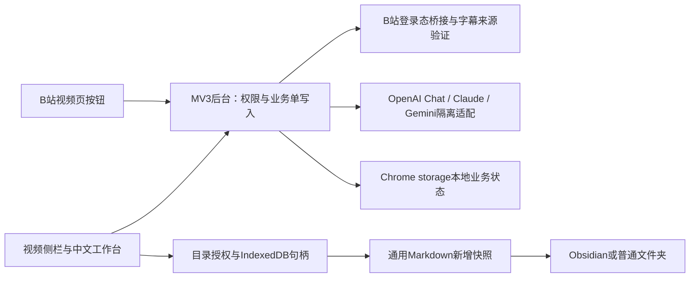

# 实现架构与边界

## 组件

- `background.js`：业务消息只对本扩展页面开放。内容脚本仅能打开侧栏或记录分享入口点击；不能读取设置或资料。后台为持久状态唯一写入者，串行 `changeState` 防止异步覆盖。
- `bilibili.js`：视频身份、分P CID、WBI、分页、字幕归属、过期刷新和来源失败分类。后台通过 MAIN world 请求已有 B 站页面，不把登录凭据交给模型。
- `gateway.js`：浏览器安全 ESM，无 SDK、无隐式重试。三类协议隔离、分页有界、输出截断拒绝成功、中文错误脱敏。
- `learning.js`：确定性时间窗、事件去重、分组／分批、翻译对齐、关键词片段检索及有效引用映射。引用 ID 正确不代表语义有支持，仍需人工核对。
- `ui.js`：两入口共享本地状态，全部不可信文本用 DOM 文本节点显示。无远程脚本、内联脚本或模型 HTML 执行。
- `markdown.js` / `vault.js`：双语完整性门禁，完整对话导出，文件名保护、权限检查、已有名拒绝、同源浏览器锁及写后读回。

## 状态与任务

状态位于独立 `biliStudy` 命名空间，schemaVersion=1。秒级 B 站事件转换为毫秒后保存；日报按配置时区的自然日，周报为自然周的周一至今。收藏、观看、分享意图是不同事件，不根据 AI 推测补齐。

任务 `queued → running → done`，分段完成可回到 queued 保存检查点；错误为 failed 或 unknown。开始运行时生成 runId，每个结果提交必须仍匹配运行身份且未取消。服务线程启动看到遗留 running，将其停为 unknown；不会自动付费重发。取消、清除或关闭自动任务会使旧执行者的结果失效。账号切换要求清除旧账号关联，尚不支持多账号同时存储。

中断、超时或取消不能保证上游没有计费，也不能保证恰好一次；没有上游幂等键和严格分布式租约。手动重试会确认风险。401/403/429 暂停后续排队任务，避免成批重复失败。

新摘要和人工编辑都保留此前版本；报告重算保留此前报告。字幕当前使用按分集缓存，不自动探测字幕修订，也没有完整来源版本图。不要将代码存在描述成 PRD 所有版本化契约已经达成。

## 本地文件

目录仅由用户选择，不扫描 Obsidian 既有文件。每次保存生成时间＋随机标识快照；先检查同名，不存在才创建，写后读回。Web Locks 串行同一扩展来源的写入，但不能排除外部进程在检查与创建之间竞争。没有持久化导出意图回执、跨进程原子不覆盖或未知保存状态的完全恢复。保存失败后优先导出已生成资料，不重新调用模型。

## 固定边界

模型发现总时限30秒，生成90秒，响应／请求上限2MiB；翻译批最多12组、约6500字符；精读先按约4000字分批，任务内最多2路并行，全部完成后串行生成一次导读与复习材料；问答取证约26000字符。单个持久任务内部可以并行，但跨任务队列仍保持顺序执行。每个成功批次独立保存检查点，重试只补未完成批次。超长讨论整理和报告明确拒绝，不静默丢尾。收藏／历史每轮各最多10页，并保留范围受限标记。浏览器本地存储容量耗尽时停止写入并给中文提示，不静默清理用户资料。

这些是实现者的当前安全默认值，不等于用户已经批准所有 PRD 参数。真实来源覆盖、七家服务生成质量、Edge 文件夹授权、批量任务长期恢复和 PRD 未完成契约仍需验收。
